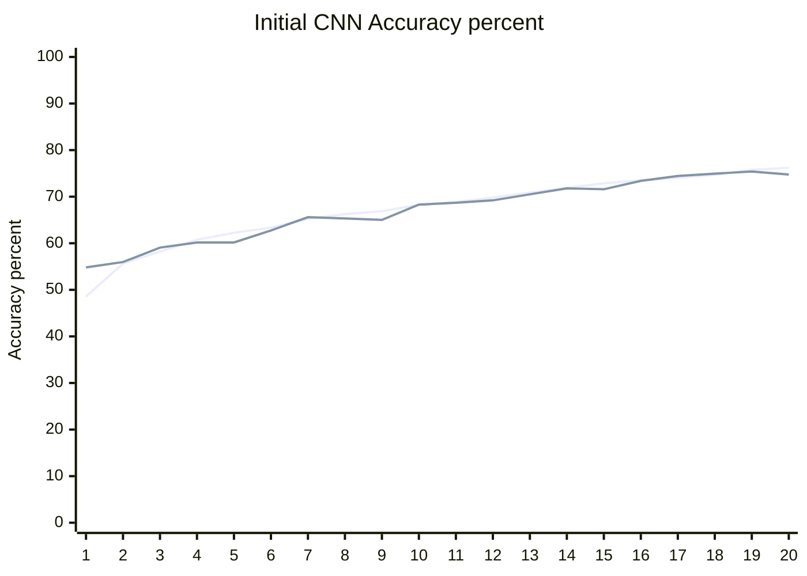
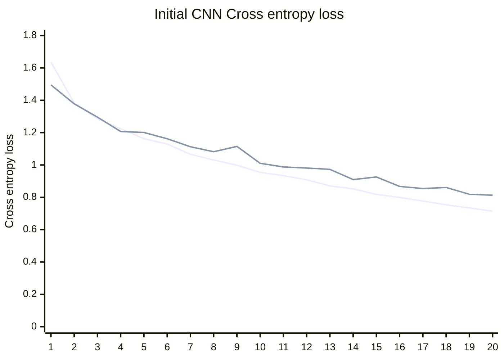
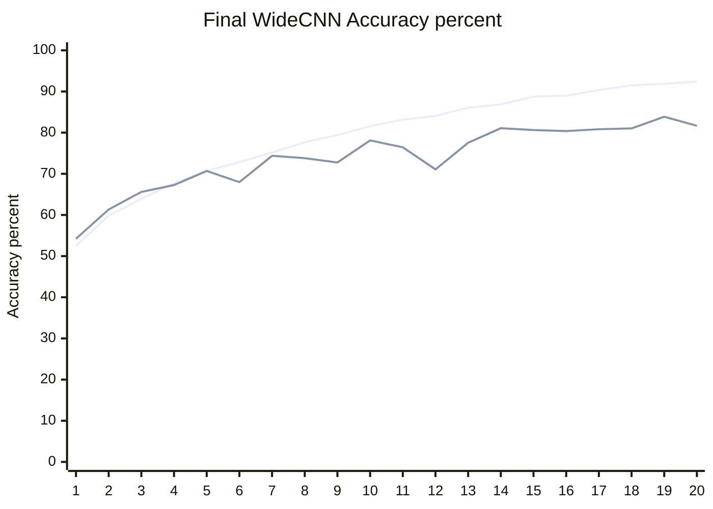
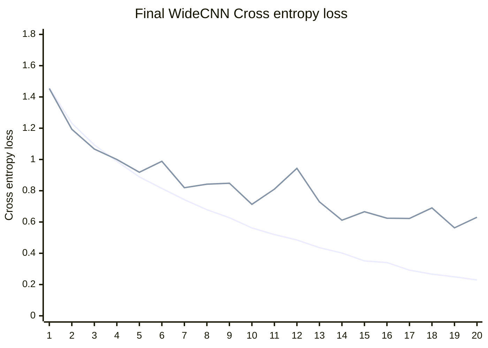
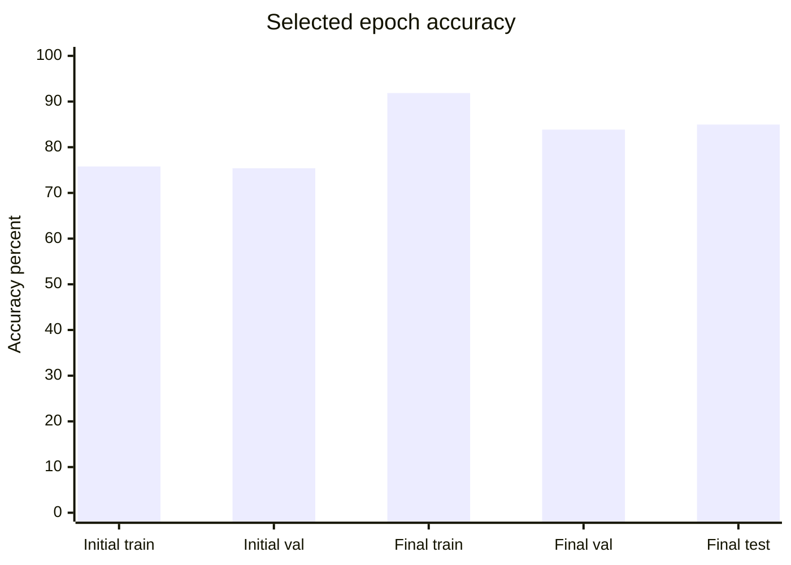
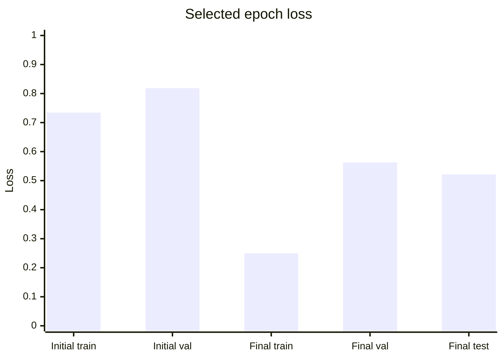

# 쓰레기 이미지 분류

계명대학교 경영정보학과 **남종욱** · 빅데이터프로그래밍 1차 해커톤

PyTorch로 직접 구현한 4블록 CNN으로 쓰레기 이미지를 12개 클래스로 분류합니다. V1에서 구조와 하이퍼파라미터를 비교한 뒤, 오분류가 많았던 클래스를 V2 이미지로 보강했습니다. **같은 V1 시험셋에서 정확도가 84.97%에서 87.48%로 올랐습니다.**

## 제출 파일과 실행

| 파일 | 내용 |
| :---- | :---- |
| `garbage_classifier_v2_added.ipynb` | 데이터 수집·EDA·정제, V2 선별·이어 학습, 두 모델의 시험 성능 비교, 이미지 업로드 예측 |
| `README.md` | 실행 방법과 주요 결과 |
| Word 및 PDF 보고서 | 제작 과정, 하이퍼파라미터 탐색, 학습 그래프·혼동행렬, AI 프롬프트 |

garbage\_classifier\_v2\_added.ipynb을 Colab에서 열고 위에서부터 실행합니다. 두 데이터셋은 KaggleHub로 가져오며 캐시가 없으면 Colab 런타임에 받아옵니다.

1. 기본값 `RETRAIN_V2=False`는 셀에 내장한 V1·V2 가중치로 시험을 평가합니다. V1은 학습 당시 분할을 불러오고, V2는 버전과 분할 순서·seed를 고정해 재구성합니다. 기존 실행 기록과 실제 평가값은 장치·라이브러리에 따른 수치 차이가 날 수 있습니다.  
2. 마지막 셀은 교수님이 별도 이미지를 업로드하여 최종 모델의 상위 3개 예측을 확인할 때 실행합니다. 전체 셀을 실행하면 마지막에 파일 선택 창이 표시됩니다.

`RETRAIN_V2=True`로 바꾸면 기존 V1 가중치에서 이어 학습하는 과정도 실행할 수 있습니다. 기본 평가에는 Google Drive 마운트나 별도 가중치 파일이 필요 없습니다.

## 데이터와 전처리

출처: [Kaggle Garbage Classification](https://www.kaggle.com/datasets/mostafaabla/garbage-classification)

원본 15,515장에서 레이블 충돌 6장과 동일 클래스 중복 여분 16장을 제외하여 **15,493장**을 사용했습니다. 학습 12,394 / 검증 1,549 / 시험 1,550장으로 분할했습니다. 정확히 같은 파일의 중복을 제거했으며, 유사 이미지까지 그룹으로 분리한 것은 아닙니다.

모든 이미지는 RGB로 변환하고 128×128로 크기를 맞춘 뒤, 채널별 mean=0.5, std=0.5로 정규화했습니다. V1 기준 실험은 지정 데이터와 직접 학습한 가중치를 사용했습니다. CNN은 PyTorch로 구현하고 torchvision은 전처리, scikit-learn은 데이터 분할과 평가 지표 계산에 사용했습니다.

## V1에서 선택한 모델 설정

`WideCNN`은 직접 작성한 CNN의 클래스 이름입니다. Conv→BatchNorm→ReLU→MaxPool을 네 번 쌓고, GAP→Linear로 12개 클래스를 분류합니다.

| 항목 | 선택 설정 |
| :---- | :---- |
| 블록 수 | 4 |
| 필터 수 | 64→128→256→256 |
| 파라미터 수 | 965,388 |
| 입력 크기 | RGB 128×128 |
| Optimizer·학습률 | Adam, 0.005 |
| 배치 크기 | 32 |
| 학습 횟수 | 20 epoch |
| 모델 선택 기준 | 검증 정확도가 가장 높은 epoch |
| Dropout·데이터 증강 | 최종 모델에서는 미적용 |

V1 실험에서는 19번째 epoch의 가중치를 선택했습니다. 이 가중치가 V2 이어 학습의 시작점입니다.

## 최초 CNN과 V1 WideCNN 비교

Train은 선택 epoch의 **학습 중 측정값**이며, Validation과 Test는 선택된 가중치를 eval 모드에서 평가한 값입니다. 최초 모델의 Test는 측정 기록이 없습니다.

| 모델 | 선택 epoch | Train 정확도 | Train loss | Validation 정확도 | Validation loss | Test 정확도 | Test loss |
| :---- | ----: | ----: | ----: | ----: | ----: | ----: | ----: |
| 최초 3블록 CNN | 19 | 75.79% | 0.7345 | 75.40% | 0.8188 | 미측정 | 미측정 |
| 최종 4블록 WideCNN | 19 | 91.86% | 0.2493 | 83.86% | 0.5626 | **84.97%** | **0.5212** |

아래 곡선은 첫 번째 선이 Train, 두 번째 선이 Validation이며 x축은 epoch입니다. Test는 최종 모델 선택 후 한 번 평가했으므로 epoch별 곡선으로 만들지 않았습니다. 원본 학습 곡선과 최종 시험점을 함께 표시한 그림은 보고서에 포함했습니다.

&nbsp;

&nbsp;

&nbsp;

&nbsp;

다음 그래프는 선택 epoch의 Train·Validation과 최종 Test 성능을 요약합니다. 최초 모델의 미측정 Test 항목은 포함하지 않았습니다.

&nbsp;

&nbsp;

V1 기준 시험은 **1,550장 중 1,317장 정답 / 233장 오답**, Accuracy **84.97%**, loss **0.5212**, Macro F1 **81.16%**, Macro Recall \*\*80.73%\*\*였습니다. 별도로 생성한 이미지에 대한 성능을 측정한 결과는 아닙니다.

## 하이퍼파라미터 비교와 선택

학습률과 규제 방법을 먼저 비교하고, 모델의 깊이·필터 수·입력 크기를 조정한 뒤 큰 모델에서 학습률과 규제 효과를 다시 확인했습니다. 실제 탐색은 직접 작성한 반복문으로 수행했습니다.

| 비교 항목 | 실제 완료 후보 | 결과 및 선택 |
| :---- | :---- | :---- |
| 학습률 | 0.01, 0.001, 0.005, 0.0001 | 3블록에서는 0.005 최고 76.63%; 0.05는 중도 제외 |
| Dropout | 0, 0.1, 0.2, 0.3, 0.4, 0.5 | 3블록 미적용 76.63% 최고 |
| BatchNorm | 없음 / 있음 | 76.63% → 78.37% |
| 증강 | 없음 / 기하 / 기하+조명 | 3블록은 미적용 78.37% 최고 |
| 블록 수 | 3 / 4 | 78.37% → 82.25% |
| 필터 수 | (16,32,64,64) / (32,64,128,128) / (64,128,256,256) | 80.96% / 82.25% / 83.86% |
| 구조 변경 후 lr 재비교 | 0.005 / 0.001 | 4블록 82.25% / 81.79%; Wide 83.86% / 83.15% |
| 입력 크기 | 128 / 224 | 83.86% / 80.83% |
| Wide 규제 재확인 | 없음 / Dropout 0.1 / 기하+조명 | 83.86% / 82.50% / 82.57% |

증강은 회전 ±10도, 이동 최대 5%, scale 0.95\~1.05, 수평 반전 확률 0.5, 밝기·대비 각 0.15를 비교했습니다. 유리 색상 클래스를 보존하기 위해 hue는 변경하지 않았습니다. 이번 조건에서는 증강을 적용하지 않은 최종 모델의 전체 검증 성능이 가장 높았습니다.

하이퍼파라미터 탐색 과정과 비교 코드는 [별도 실험 저장소](https://github.com/njw257/bigdata)에 정리합니다.

## 과적합과 결과 해석

최종 구조의 마지막 epoch에서는 Train 정확도 92.38%, Validation 정확도 81.67%로 차이가 있었고 후반 검증 성능이 변동했습니다. 학습 중 측정값과 eval 평가값의 조건 차이를 고려하면서 과적합 가능성과 학습 불안정성을 점검했고, 마지막 epoch 대신 검증 최고 가중치를 선택했습니다.

Dropout과 데이터 증강도 실제 비교했으나 이번 학습 조건에서는 전체 검증 성능을 높이지 못했습니다. 단일 seed와 정해진 후보 범위에서 얻은 결과이므로 다른 데이터나 학습 조건에서도 같은 순위가 유지된다고 보장하지는 않습니다.

클래스별 성능과 원본 혼동행렬은 노트북의 시험 평가 출력에서 확인할 수 있습니다. 보고서에는 건수·행 정규화 혼동행렬과 해석을 함께 제시했습니다. 주요 오분류는 shoes→clothes 14장, biological→shoes 10장, plastic→paper 10장, white-glass→plastic 10장이었습니다.

## V2 추가 학습

[Kaggle Garbage Classification V2 v12](https://www.kaggle.com/datasets/sumn2u/garbage-classification-v2/versions/12)의 `original`에서 V1과 겹치는 이미지 및 내부 중복을 검사했습니다. 새로 선별한 1,565장은 `biological` 60장, `plastic` 964장, `trash` 222장, `metal` 319장이며 학습 1,253장, 검증 156장, 보류 시험 156장으로 분리했습니다.

기존 WideCNN으로 시작해 합본 학습 13,647장과 검증 1,705장을 사용했습니다. Adam 학습률 0.0003, 배치 32로 10 epoch를 실행했고 검증 정확도 85.57%를 기록한 4번째 epoch의 가중치를 선택했습니다.

| 시험셋 | 정확도 (%) | Loss | Macro F1 (%) | Macro Recall (%) |
| :---- | ----: | ----: | ----: | ----: |
| V1 시험 (1,550장) | 84.97 → 87.48 | 0.5212 → 0.4099 | 81.16 → 84.33 | 80.73 → 84.20 |
| V2 보류 시험 (156장) | 32.05 → 70.51 | 3.1650 → 0.9435 | 41.09 → 73.28 | 31.87 → 66.15 |

두 모델을 같은 사진으로 비교했습니다. V1에서 `biological` 재현율은 66.67%에서 88.89%, `plastic`은 66.67%에서 75.86%로 올랐고, `paper`는 92.38%에서 87.62%로 내려갔습니다. 보강 대상 선정에 V1 시험 결과를 참고했습니다. V2 보류 시험은 4개 클래스의 평가이며, 교수님의 별도 이미지 성능은 해당 이미지에서 확인해야 합니다.

## 생성형 AI 활용

Codex를 데이터 분석, CNN 구현, 실험 설계, 오류 수정과 결과 정리에 활용했습니다. 학습·평가는 작성자가 Colab에서 실행하고 결과를 확인했으며, 실제 대표 프롬프트와 활용 내역은 보고서에 기입했습니다.

그래프는 Mermaid 문법을 사용합니다. Markdown 뷰어가 이를 지원하지 않으면 [GitHub의 Markdown 보기](https://docs.github.com/en/get-started/writing-on-github/working-with-advanced-formatting/creating-diagrams)나 보고서의 그림으로 확인할 수 있습니다.